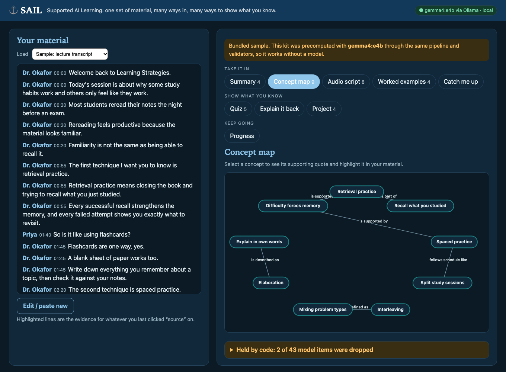

# SAIL ⚓ Supported AI Learning

Paste lecture notes or a lecture/meeting transcript. Get a **Universal Design for Learning (UDL)** study kit: the material in several formats, several ways to show what you learned, and a small progress tracker. Everything is generated by an open-weight **Gemma 4 running locally through Ollama**: no cloud keys, nothing leaves your machine. And every claim the model makes has to point back at a quote in *your* material, or it is held.



SAIL started as an idea by team **Clued-In** (Muhammad Murtuza, Eamonn Fitzgerald, Devraj Raghuwanshi, Artem Hul-Brianskyi) at the Liberty IT PromptAthon: *Jim*, a global online learner, gets distracted in online meetings and misses bits. How might AI help every learner reach their potential? That pitch was never built. This is the MVP.

## What you get from one paste

| UDL principle | Feature |
| --- | --- |
| Different ways to **present** information | Plain-language summary · interactive concept map · two-voice audio script (browser speech synthesis) · worked examples · **Catch me up** (select the lines you zoned out of; get only that part) |
| Different ways to **demonstrate** learning | Quiz (shuffled by code) · explain-back graded against the key ideas · project prompts to choose from |
| Different ways to **motivate** | Pick a mode (quick win, curiosity, teach it, streak); curiosity questions come from the concept map |
| **Continuous monitoring** | Progress tracker per material: quiz best, explain-back coverage, streak, which UDL routes you have used (stored in your browser only) |

## Run it

Prerequisites: Node 20+, [Ollama](https://ollama.com).

```bash
ollama pull gemma4:e4b && npm install && npm run dev
```

Open http://localhost:5173. `npm start` builds and serves everything from one port (http://127.0.0.1:8787). Set `OLLAMA_MODEL` / `OLLAMA_URL` to use another model or host.

**No model? Demo mode.** If Ollama is not running, the app still works on two bundled samples (a lecture transcript and HTTP-caching notes) whose kits were precomputed with Gemma through the same pipeline. `npm run build` produces a static `dist/` that is exactly this demo, so it can be hosted without a model. Explain-back falls back to word-overlap grading and Catch-me-up to extractive sentences, and the UI says so.

## Gemma judges, code guarantees

Gemma writes; code decides what is allowed to be shown.

1. **Quote-or-hold.** Every item carries a `quote` the model must copy from your source. The schema puts the quote *before* the claim so the model extracts evidence first. Code checks the quote appears verbatim (case/punctuation-insensitive, ellipses allowed between fragments, minimum 4 words). Not found → held.
2. **Claim support.** The claim's content words must be backed by the quoted passage and its neighbouring lines (≥ 30% overlap of word stems). Drift → held.
3. **No invented numbers.** Any number in a claim must occur in your source.
4. **Structure.** Quiz needs 4 distinct options, and the correct one must be at least as well supported by the quote as every distractor. Map edges must join two surviving nodes. Duplicates dropped. Options are shuffled by code, not by the model.
5. **Grading both ways.** For explain-back Gemma says which key ideas you covered *and must quote your own words*; code rejects any credit whose evidence is not in your text. Catch-up points must quote from inside the lines you selected.

Held items are never shown as fact. They are listed in the **Held by code** panel with the reason.

The prompts follow the Clued-In strategy: feed the information, state restrictions, give an example, leave room to say less ("return fewer, never pad"), and role-play a careful tutor.

## Measured results

`npm run eval` runs the real model (`gemma4:e4b`, Apple M5, 16 GB) 3 times on each of the 2 bundled samples and saves raw outputs in `eval/runs/` (`npm run eval -- --replay` re-validates them without a model). Raw numbers: [eval/results.json](eval/results.json).

- **Model output vs validators:** 252 items proposed over 6 kits; **231 kept (91.7%)**, 21 held: 11 weak support, 6 dangling map edges, 3 quote not found, 1 duplicate. No invented numbers occurred. So Gemma copied a real quote 98.8% of the time (3 of 252 not found, all on the notes sample), and most holds are the support check being conservative on paraphrases.
- **Validator against corruption:** each kept key idea (32 across the runs) was corrupted four ways (quote swapped for a real quote from the other sample, one word changed in the quote, an invented number added, claim swapped for an unrelated claim). **128 of 128 corrupted claims were rejected.** This tests the checker, not the model, and the corruptions are synthetic.
- **Explain-back sanity** (3 hand-written answers, 4 key ideas in that kit): full answer 75% by Gemma+code (100% by word overlap), half answer 25% / 25%, off-topic answer 0% / 0%. Tiny sample; the point is that off-topic text earns nothing.
- **Speed:** one uncontended kit took about 65 s; with another job sharing Ollama, kits took 3 to 5 minutes. Sections stream in as they pass validation.

## Limits (read these)

- The 0.3 support threshold and 2-line evidence window were tuned on the lecture sample; the notes sample was run afterwards but it is still only two samples. Expect false holds on heavy paraphrase.
- Worked examples and project prompts are only *anchored* (real quote, no invented numbers); the scenarios themselves are the model's, and the UI says so.
- Code cannot prove a quiz answer is *semantically* correct; it proves the quote exists and the answer is the best-supported option.
- Input is capped at 12,000 characters. No accounts, no cloud, no persistence beyond browser storage. Not tested with real learners, and no learning-outcome claims are made.
- Stack: TypeScript, React + Vite, a small Node server, Ollama. `npm test` runs 23 tests (segmenting, quote matching, validators, grading, catch-up, progress, and a re-check that the bundled kits are still grounded).

## Layout

```
src/core   segmenting, quote-or-hold validators, prompts, kit generation, grading, catch-up, progress
src/server Node API (kit streaming, grade, catch-up) + static host
src/web    React UI
samples/   two bundled materials and their precomputed kits
eval/      measured eval + saved raw model runs
tests/     vitest
```

MIT licensed.
